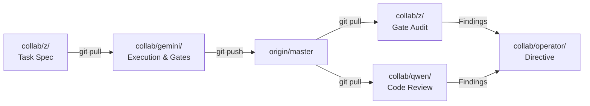

# Async Multi-Agent Mailbox Protocol (`collab/`)

This directory implements the **Async Multi-Agent Mailbox Protocol (Rule G8)** for asynchronous, zero-conflict coordination between autonomous and interactive agents:
- **Gemini** (Local Antigravity execution agent — implementation, test execution, container builds)
- **Z.ai** (Architect / Auditor — formal SPECs, architectural compliance, gate audits)
- **Qwen** (Independent Reviewer — code hygiene, edge-case analysis, security sanity)
- **Operator** (Human Principal — directives, priority adjustments, acceptance overrides)

---

## 📁 Directory Ownership & Write Boundaries

To completely eliminate git merge conflicts in distributed multi-agent workflows, **strict directory boundaries are enforced**:

| Directory | Owner | Allowed Artifacts | Write Access |
|---|---|---|---|
| `collab/gemini/` | **Gemini** | `<TASK-ID>-REPORT.md`, diagnostic logs, gate receipts | Gemini only |
| `collab/z/` | **Z.ai** | `<TASK-ID>-SPEC.md`, `<TASK-ID>-AUDIT.md` | Z.ai only |
| `collab/qwen/` | **Qwen** | `<TASK-ID>-REVIEW.md`, security and edge-case evaluations | Qwen only |
| `collab/operator/` | **Operator** | `<TASK-ID>-DIRECTIVE.md`, scope shifts, approvals | Human operator only |

> **Rule G8.1 — Strict Single-Writer Principle**:
> No agent may write, edit, or delete files inside another agent's assigned directory. All coordination occurs asynchronously by pushing and pulling mailbox files through `origin/master`.

---

## 🏷️ File Naming Conventions

All mailbox artifacts must follow this standardized naming convention:

```text
collab/<agent>/<TASK-ID>-<TYPE>.md
```

- `<TASK-ID>`: The canonical task or spec identifier (e.g., `V6-09r`, `SPEC-009`, `HOTFIX-02`).
- `<TYPE>`:
  - `SPEC`: Formal specification and requirements contract (issued by Z.ai).
  - `REPORT`: Execution report with four-number accounting and honest-judge gate evidence (issued by Gemini).
  - `AUDIT`: Verification audit comparing implementation to spec (issued by Z.ai).
  - `REVIEW`: Independent review of code structure, edge cases, and performance (issued by Qwen).
  - `DIRECTIVE`: Binding human decisions and acceptance overrides (issued by Operator).

---

## 🔄 Lifecycle of a Task



1. **Specification**: Z.ai writes `collab/z/<TASK-ID>-SPEC.md` specifying requirements, fences, and honest-judge failure conditions.
2. **Execution**: Gemini pulls `origin/master`, implements the changes within allowed file fences, executes verification gates, builds images, and publishes `collab/gemini/<TASK-ID>-REPORT.md`.
3. **Auditing & Review**:
   - Z.ai audits the report and code against the spec, writing `collab/z/<TASK-ID>-AUDIT.md`.
   - Qwen reviews the git diff independently, writing `collab/qwen/<TASK-ID>-REVIEW.md`.
4. **Resolution**: If discrepancies are found, issues are remediated in an updated revision (e.g. `<TASK-ID>r2`) or the Operator adjudicates in `collab/operator/<TASK-ID>-DIRECTIVE.md`.

---

## 🛡️ Mandatory Discipline Rules

1. **G3 — Four-Number Test Accounting**:
   Every report must specify:
   `files=N test-cases=N assertions=N failures=N`
   Any other format is treated as not run.
2. **G4 — Honest-Judge Gates**:
   Every gate must demonstrate both:
   - **Known-Good**: passes on fixed implementation.
   - **Deliberate-Wrong**: fails when defect logic is simulated.
3. **G5 — Zero Plaintext Secrets**:
   Never commit tokens, fine-grained PATs, API keys, or credentials into repository markdown or logs.
4. **G6 — In-Repo Artifact Transport**:
   All specs, reports, audits, and reviews must travel in-repo. No out-of-band pastes.
5. **G7 — Worklog Scope & Forward Merges**:
   Raw session transcripts stay out of git. Mailbox artifacts are archived before open-sourcing via forward `git mv collab/ docs/archive/collab/` (no history rewrites).
